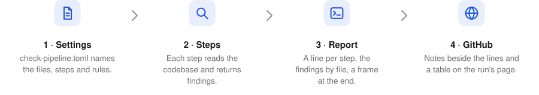

<p align="center">
  
</p>

Runs every check a project has, one step after another, with one command on your machine and the same command on
GitHub. Built-in checks catch secrets, unsafe workflows, dead code, copied code, deep nesting, broken links and much
more; your own checks and tools join as steps of their own. The pipeline tests itself: samples hold a planted mistake
for every rule, and the checks must find exactly those.

## What it does

<picture>
  <source media="(prefers-color-scheme: dark)" srcset="assets/pictures/features-dark.svg">
  
</picture>

## Install

Python 3.13 or newer. The steps that read Swift's index need Swift; the spelling and translation steps need macOS
and are skipped elsewhere, with a line that says so.

```bash
pip install git+https://github.com/Robertwlt03/check-pipeline@v0.1.0
```

## Use

Run it in your project's root. Without settings it runs the steps that need nothing but the files themselves:

```bash
check-pipeline
```

```bash
check-pipeline secrets nesting
```

<picture>
  <source media="(prefers-color-scheme: dark)" srcset="assets/pictures/terminal-dark.svg">
  
</picture>

A `check-pipeline.toml` picks the steps and holds their rules. Every setting is optional:

```toml
name = "My App"
steps = ["build", "tests", "lint", "secrets", "architecture", "deadcode", "house-rules"]

[groups]                       # check-pipeline code runs one group, such as one CI job
code = ["build", "tests", "lint", "deadcode"]
safety = ["secrets", "architecture", "house-rules"]

[files]                        # globs over the files git knows
swift_sources = ["Sources/**/*.swift"]
python_scripts = ["scripts/**/*.py"]
exclude = ["Generated/**"]

[architecture]                 # each folder below Sources and the folders it may use
may_use = { Features = ["Models", "Services"], Services = ["Models"], Models = [] }

[commands.lint]                # any tool whose lines name a file and a line
title = "SwiftLint"
command = ["swiftlint", "lint", "--quiet", "--strict"]

[custom.house-rules]           # your own check: a function that returns findings
title = "House rules"
function = "scripts/house_rules.py:house_rule_problems"
```

## The built-in steps

| Step | What it checks | Settings |
|---|---|---|
| `secrets` | private keys, tokens, passwords in settings; local settings a Makefile reads are ignored by git | |
| `security` | shells that read text as commands, `eval`, fixed temporary paths, signing without hardened runtime, Swift safety switches without a reason, workflows strangers could steer, unpinned actions | |
| `duplicates` | the same six lines of substance in two places, also when only values changed | |
| `nesting` | at most two blocks deep in a method, Swift and Python | |
| `guides` | links in Markdown lead somewhere; American spelling on macOS | |
| `files` | images and media no file names | |
| `deadscripts` | Python functions, settings and imports nothing uses | |
| `scripts` | scripts read as their tool reads them, short lines, an optional shared head | `[scripts] head`, `no_shell_scripts` |
| `english` | German outside the translations | |
| `commits` | Conventional Commits, line lengths, American spelling on macOS | `[commits] since`, `samples` |
| `output` | output only through [console-look](https://github.com/Robertwlt03/console-look) | `[console_output] may_print` |
| `build`, `tests`, `coverage` | `swift build` without warnings, `swift test`, coverage per folder | `[swift]`, `[coverage] minimum`, `not_measured` |
| `deadcode` | Swift declarations nothing uses, properties nothing reads (compiler index) | `[dead_code] text_keys` |
| `architecture` | which folder may use which (compiler index) | `[architecture] may_use`, `own_parts` |
| `promises` | interfaces that would break a promise, such as going online (compiler index) | `[[promises]]` |
| `disk` | disk access only off the main thread (compiler index) | `[disk_access] left_out`, `interfaces` |
| `accessibility` | every SwiftUI image decided for VoiceOver (compiler index) | |
| `language` | names and comments in American English, no abbreviations (macOS) | `[language] terms` |
| `translations` | texts copied from English instead of translated (macOS) | `[translations] tables` |
| `plists` | property lists and `.strings` files read by `plutil` (macOS) | |
| `samples` | every planted mistake found, nothing else (macOS) | `[samples] folder` |

`check-pipeline coverage-report` prints the coverage of each folder without judging it.

## Your own checks

A check is a function that takes the codebase and returns its findings, each `path:line: message`. The codebase holds
the file lists (`swift_sources`, `python_scripts`, `guides`, `text_files` …), the settings and helpers such as
`numbered_lines` and `place`:

```python
from check_pipeline.project import Codebase, numbered_lines, place


def fixme_problems(codebase: Codebase) -> list[str]:
    return [
        f"{place(path, number)}: a FIXME left in the code"
        for path, number, line in numbered_lines(codebase.swift_sources) if "FIXME" in line
    ]
```

A `[custom.<name>]` or `[commands.<name>]` with the name of a built-in step replaces it, so a project can sharpen or
loosen any rule.

## How it tests itself

<picture>
  <source media="(prefers-color-scheme: dark)" srcset="assets/pictures/flow-dark.svg">
  
</picture>

A samples folder is a small codebase with its own `check-pipeline.toml`. Each mistake in it carries a note,
`expect: <part of the finding>` on its line or `expect below: …` on the line above. The `samples` step runs every
check that reads code on it and fails when a planted mistake is not found, or when something else is.
[`Tests/samples`](Tests/samples) does this for every built-in check and for a custom one.

## On GitHub

Each finding becomes an annotation beside its line in the pull request, and the run's summary page gets a table of the
steps. Groups split the work into jobs; the commits step needs the history:

```yaml
- uses: actions/checkout@3d3c42e5aac5ba805825da76410c181273ba90b1  # v7.0.1
  with:
    fetch-depth: 0
    persist-credentials: false
- run: pip install git+https://github.com/Robertwlt03/check-pipeline@v0.1.0
- run: check-pipeline code
```

## Contribute

Issues and pull requests are welcome. Install it editable, then run its own pipeline, which includes the unit tests
and the samples:

```bash
pip install -e .
```

```bash
check-pipeline
```

## License

[MIT](LICENSE)
